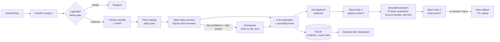
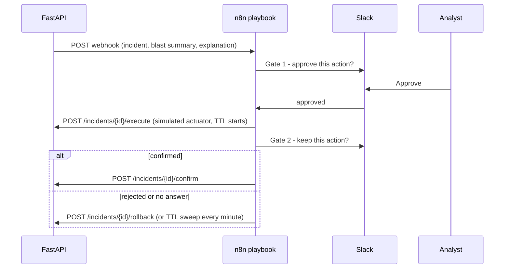

# Security Orchestration Agent

An AI-driven SOAR (Security Orchestration, Automation and Response) platform that detects malicious network flows, classifies them into seven attack families with confidence scores, and responds safely with a human in the loop.

Each detection is matched to a response from an editable **policy catalog**, and the system **previews the blast radius** before any destructive action. Destructive actions pass through **two Slack approval gates** orchestrated by an **n8n playbook**, run against **simulated actuators**, and **roll back automatically** after a time limit unless an analyst confirms them. Every incident gets a SHAP-grounded explanation that is checked for accuracy, and every decision is recorded in a tamper-evident audit trail and shown on a live SOC dashboard.

> All response actions (IP block, host quarantine, account disable, rate limit) are **simulated**; no real firewall or identity system is touched.

---

## Dashboard

The Streamlit SOC dashboard shows incidents, pending approvals, active responses, the audit log and SOC performance metrics.

**Local:** http://localhost:8501 (start it with `streamlit run dashboard/app.py`, see [Getting started](#getting-started))

---

## Architecture



---

## Approval Flow



Non-destructive responses (for example a rate limit) skip the gates and execute automatically. The API itself refuses to run a destructive action unless an approver is supplied (HTTP 403), so safety does not depend on the playbook alone.

---

## Features

| Area | What it does |
|---|---|
| **Detection** | Binary gate (benign vs malicious) followed by a 7-family classifier with a confidence score |
| **Attack families** | DoS, DDoS, PortScan, BruteForce, WebAttack, Botnet, Infiltration |
| **Risk scoring** | Risk 0-100 from family weight, P(malicious) and confidence, mapped to low / medium / high / critical |
| **Response policy** | Per-family actions, TTLs and thresholds in `policy.yaml`, editable without code changes or restarts |
| **Blast radius** | Impact score from benign-traffic share, dependent services and asset criticality (SQL over a synthetic asset inventory) |
| **Safety downgrade** | Low-confidence and high-impact destructive actions are downgraded automatically (for example block to rate limit) |
| **Human approval** | Two Slack gates via n8n "send and wait", each showing the blast-radius summary |
| **Auto-rollback** | Every action has a TTL; unconfirmed actions are rolled back by an n8n schedule trigger |
| **Explainability** | SHAP top-5 feature attribution plus an LLM-written explanation (Groq or Ollama) |
| **Explanation quality check** | A rule-based checker verifies every feature an explanation cites appears in the SHAP output; unsupported text is regenerated, then replaced by a SHAP template and flagged |
| **Audit trail** | SHA-256 hash-chained log of detections, decisions, approvals, actions and rollbacks, with an integrity check endpoint |
| **SOC metrics** | Mean time to detect, mean time to respond, approval latency, auto-resolved vs human-handled share, rollback count, explanation pass rate |

---

## Tech Stack

| Layer | Tools |
|---|---|
| Machine learning | Python, scikit-learn, LightGBM, pandas, NumPy |
| Explainability | SHAP |
| API and mock actuators | FastAPI, Pydantic |
| Orchestration | n8n (self-hosted community edition): webhooks, send-and-wait approvals, schedule trigger |
| Containerization | Docker (runs the self-hosted n8n container) |
| Approvals | Slack (through n8n) |
| LLM explanations | Groq or Ollama |
| Storage | SQLite (asset inventory, incidents, audit log) |
| Dashboard | Streamlit |
| Dataset | CICIDS2017 |

---

## Getting Started

### Prerequisites
Python 3.11+, Docker Desktop (to run n8n), a Slack workspace, and a Groq API key (or a local Ollama install).

### 1. Install
```bash
git clone https://github.com/mehak2710/security-orchestration-agent.git
cd security-orchestration-agent
python -m venv .venv
.venv\Scripts\Activate.ps1          # macOS/Linux: source .venv/bin/activate
pip install -r requirements.txt
```

### 2. Get the data and train the models
Download `MachineLearningCSV.zip` from the [CIC-IDS2017 page](https://www.unb.ca/cic/datasets/ids-2017.html), extract the eight CSV files into `data/raw/`, then run:
```bash
python -m ml.train
```
This removes NaN, infinite and duplicate flows, trains both models, prints classification reports, and writes `models/models.joblib` and `data/sample_flows.csv`. If `data/raw/` is empty, the trainer falls back to clearly labelled synthetic demo data.

### 3. Configure
```bash
cp .env.example .env        # Windows: copy .env.example .env
```
Set `GROQ_API_KEY`, or use `LLM_PROVIDER=ollama` or `LLM_PROVIDER=none` for template explanations.

### 4. Start the API and dashboard
```bash
uvicorn app.main:app --port 8000 --env-file .env
streamlit run dashboard/app.py
```

### 5. Set up the n8n playbook (Slack approvals)
1. Create a Slack app with the bot scopes `chat:write` and `channels:read`, install it to your workspace, and invite the bot to your approvals channel.
2. Expose n8n publicly so Slack's approval links resolve, for example with `cloudflared tunnel --url http://localhost:5678`, then start n8n with that URL:
   ```bash
   docker run -it --rm -p 5678:5678 -v n8n_data:/home/node/.n8n \
     -e WEBHOOK_URL="https://<your-tunnel>/" n8nio/n8n
   ```
3. Open `http://localhost:5678`, import `n8n/soar_playbook.json`, attach your Slack credential and channel ID to both Slack nodes, and click **Publish**.

n8n runs in Docker and calls the API at `http://host.docker.internal:8000`.

### 6. Generate traffic
```bash
python -m scripts.simulate -n 5 --family DDoS        # destructive: needs approval in Slack
python -m scripts.simulate -n 5 --family PortScan    # non-destructive: handled automatically
python -m scripts.simulate -n 5 --family Botnet --ambiguous --src 203.0.113.10 --host auth-01
#   low confidence + high impact: the action is downgraded to rate_limit
```

---

## Demo Walkthrough

1. **Detect:** the simulator replays held-out CICIDS2017 flows to the `/analyze` endpoint.
2. **Decide:** the incident receives a family, a confidence score, a risk score and a policy-selected action.
3. **Preview:** a blast-radius summary is attached, for example "85% of this source's traffic is benign and two services depend on web-01".
4. **Approve:** Slack Gate 1 shows the evidence and blast radius, and the analyst approves or rejects.
5. **Act:** the simulated actuator runs and the TTL starts; Gate 2 asks whether to keep the action.
6. **Roll back:** with no confirmation, the scheduled sweep reverts the action and the audit log records it.
7. **Verify:** `GET /audit/verify` confirms the audit log has not been altered.

---

## API Reference

Interactive Swagger documentation is available at **http://localhost:8000/docs** once the API is running.

---

## Project Structure

```
├── app/                      FastAPI service
│   ├── main.py               endpoints, decision logic, playbook steps, metrics
│   ├── blast.py              blast-radius scoring (SQL over the asset inventory)
│   ├── actuators.py          simulated IP block / quarantine / account disable / rate limit
│   ├── explain.py            LLM explanation + SHAP grounding checker
│   ├── audit.py              hash-chained audit log and verification
│   └── db.py                 SQLite schema and synthetic seed data
├── ml/
│   ├── config.py             features, families, CICIDS label mapping
│   ├── train.py              data cleaning and model training
│   └── predict.py            inference and SHAP attribution
├── dashboard/app.py          Streamlit SOC dashboard
├── scripts/simulate.py       replays flows against the API
├── n8n/soar_playbook.json    n8n workflow (webhook, two Slack gates, rollback schedule)
├── policy.yaml               editable response catalog
├── requirements.txt
└── .env.example
```

---

## Future Enhancements

- Integrate real enforcement points (firewall API, EDR, identity provider) behind the actuator interface
- Record the individual Slack approver's identity in the audit log instead of a fixed label
- Anchor the audit-log head hash externally to make tampering harder, not just detectable
- Use a time-based train/test split and add drift monitoring for more realistic evaluation
- Improve rare-class detection (for example Infiltration) with resampling or additional data
- Move from SQLite to PostgreSQL for multi-user deployments
- Containerise the full stack with Docker Compose for one-command startup

---


## Author

**Mehak**
GitHub: [github.com/mehak2710](https://github.com/mehak2710)
